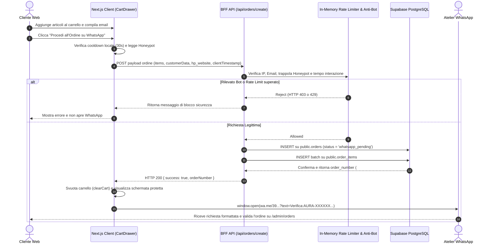
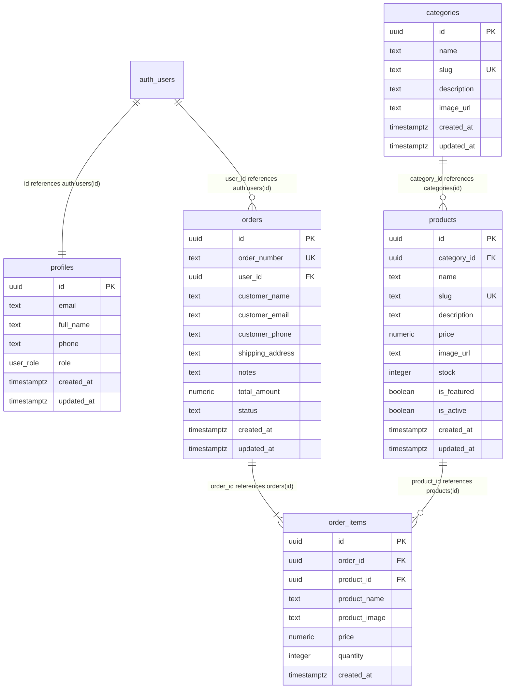

# 🏛️ Documentazione Tecnica Architetturale: Piattaforma E-Commerce "Aura Atelier" (Ecom-main)

> **Autore:** Senior Technical Writer & Full-Stack Software Architect  
> **Versione Documento:** 1.0.0  
> **Target Framework:** Next.js 14.1.0 (App Router), TypeScript 5.5, Tailwind CSS 3.4, Supabase (PostgreSQL 15)  
> **Data Ultima Revisione:** 17 Novembre 2026  

---

## Indice Generale

1. [Panoramica del Progetto e Architettura di Sistema](#1-panoramica-del-progetto-e-architettura-di-sistema)
   - 1.1 [Descrizione Generale e Modello di Business](#11-descrizione-generale-e-modello-di-business)
   - 1.2 [Stack Tecnologico Dettagliato](#12-stack-tecnologico-dettagliato)
   - 1.3 [Pattern Architetturali di Sistema](#13-pattern-architetturali-di-sistema)
   - 1.4 [Diagramma di Flusso End-to-End](#14-diagramma-di-flusso-end-to-end)
2. [Struttura delle Directory e Navigazione](#2-struttura-delle-directory-e-navigazione)
   - 2.1 [Mappatura dell'Albero del Codice](#21-mappatura-dellalbero-del-codice)
   - 2.2 [Matrice delle Rotte, Tipologia di Rendering e Permessi](#22-matrice-delle-rotte-tipologia-di-rendering-e-permessi)
3. [Autenticazione, Autorizzazione e Middleware](#3-autenticazione-autorizzazione-e-middleware)
   - 3.1 [Flusso di Autenticazione Supabase Auth SSR](#31-flusso-di-autenticazione-supabase-auth-ssr)
   - 3.2 [Role-Based Access Control (RBAC): Modello a 3 Livelli](#32-role-based-access-control-rbac-modello-a-3-livelli)
   - 3.3 [Analisi del Middleware di Sessione e Protezione Rotte](#33-analisi-del-middleware-di-sessione-e-protezione-rotte)
   - 3.4 [Misure Anti-Privilege Escalation a Livello Database](#34-misure-anti-privilege-escalation-a-livello-database)
4. [Database e Supabase](#4-database-e-supabase)
   - 4.1 [Schema Relazionale e Tabelle](#41-schema-relazionale-e-tabelle)
   - 4.2 [Row Level Security (RLS) e Funzioni SECURITY DEFINER](#42-row-level-security-rls-e-funzioni-security-definer)
   - 4.3 [Automazioni, Trigger e Manutenzione del Database](#43-automazioni-trigger-e-manutenzione-del-database)
   - 4.4 [Flussi di Migrazione, Seeding e Storage Bucket](#44-flussi-di-migrazione-seeding-e-storage-bucket)
5. [Gestione dello Stato Globale](#5-gestione-dello-stato-globale)
   - 5.1 [Architettura dello Stato con Zustand](#51-architettura-dello-stato-con-zustand)
   - 5.2 [Analisi Approfondita di useCartStore](#52-analisi-approfondita-di-usecartstore)
   - 5.3 [Analisi Approfondita di useWishlistStore](#53-analisi-approfondita-di-usewishliststore)
6. [Architettura Frontend e Componenti](#6-architettura-frontend-e-componenti)
   - 6.1 [Pagine Principali e Flussi di Visualizzazione](#61-pagine-principali-e-flussi-di-visualizzazione)
   - 6.2 [Componenti UI Core Condivisi (Design System)](#62-componenti-ui-core-condivisi-design-system)
   - 6.3 [Strategie di Fetching e Idratazione Dati](#63-strategie-di-fetching-e-idratazione-dati)
7. [API e Servizi Esterni](#7-api-e-servizi-esterni)
   - 7.1 [Documentazione Route Handlers Interni (BFF)](#71-documentazione-route-handlers-interni-bff)
   - 7.2 [Sottosistema di Sicurezza: Rate Limiting, Honeypot e Anti-Bot](#72-sottosistema-di-sicurezza-rate-limiting-honeypot-e-anti-bot)
   - 7.3 [Integrazione Cloudinary e Hosting Immagini Esterno](#73-integrazione-cloudinary-e-hosting-immagini-esterno)
   - 7.4 [Integrazione Conversational Commerce con WhatsApp](#74-integrazione-conversational-commerce-con-whatsapp)
8. [Setup, Configurazione e Deployment](#8-setup-configurazione-e-deployment)
   - 8.1 [Variabili d'Ambiente e Configurazione](#81-variabili-dambiente-e-configurazione)
   - 8.2 [Analisi di next.config.mjs e Security Headers OWASP](#82-analisi-di-nextconfigmjs-e-security-headers-owasp)
   - 8.3 [Design Tokens e Configurazione Tailwind CSS](#83-design-tokens-e-configurazione-tailwind-css)
   - 8.4 [Script npm, Polyfill e Pipeline di Deployment](#84-script-npm-polyfill-e-pipeline-di-deployment)

---

## 1. Panoramica del Progetto e Architettura di Sistema

### 1.1 Descrizione Generale e Modello di Business
**Aura Atelier** (identificativo del pacchetto `ecommerce-supabase-nextjs`, codice sorgente `Ecom-main`) è una soluzione enterprise per il commercio elettronico nel settore del lusso (*Haute Couture*, gioielleria, borse e accessori di alta moda).

L'applicazione introduce un'architettura transazionale innovativa basata sul **Conversational Commerce**:
- La navigazione, la visualizzazione del catalogo, la gestione dei filtri e la composizione del carrello avvengono in modo totalmente asincrono e reattivo sul web.
- Al momento del checkout, anziché obbligare l'utente a un gateway di pagamento con carta rigido, il sistema genera un ordine persistente all'interno del database relazionale (assegnando un **codice identificativo univoco crittografico** es. `#AURA-XXXXXX`), svuota il carrello a fini di sicurezza ed apre la chat diretta di **WhatsApp Business** con l'Atelier Concierge, precompilando l'intera distinta degli articoli, i dati di spedizione del cliente e il token di verifica dell'ordine.
- La gestione interna include un back-office a due livelli: un'area **Admin** (per la gestione ordinaria del catalogo e lo stato degli ordini) e un'area **SuperAdmin** (per la sicurezza, l'auditing sistemistico e la governance dei ruoli utente).

---

### 1.2 Stack Tecnologico Dettagliato

```
┌─────────────────────────────────────────────────────────────────────────────┐
│                                 FRONTEND                                    │
│   Next.js 14.1 (App Router) │ React 18.3 │ TypeScript 5.5 │ Tailwind 3.4    │
│   Lucide React (Stroke 1.4) │ Zustand 4.5 (Persist) │ Playfair Display/Sans │
└──────────────────────────────────────┬──────────────────────────────────────┘
                                       │ HTTPS / Cookie Session Transport
┌──────────────────────────────────────▼──────────────────────────────────────┐
│                              NEXT.JS BACKEND                                │
│   Edge & Node.js Route Handlers │ SSR Session Middleware │ Security Engine  │
│   Sliding Window Rate Limiter │ Honeypot Anti-Bot Trap │ OWASP HTTP Headers │
└──────────────────────┬───────────────────────────────┬──────────────────────┘
                       │                               │
                       ▼                               ▼
┌─────────────────────────────────────────┐  ┌────────────────────────────────┐
│            SUPABASE PLATFORM            │  │        SERVIZI ESTERNI         │
│   PostgreSQL 15 (ACID Engine)           │  │   WhatsApp Web/Universal URI   │
│   GoTrue Auth (JWT in HttpOnly Cookies) │  │   Cloudinary CDN (Predisp.)    │
│   Row Level Security (RLS) & Triggers   │  │   Unsplash High-Res CDN        │
│   Storage Bucket 'products-images'      │  └────────────────────────────────┘
└─────────────────────────────────────────┘
```

| Componente | Tecnologia | Versione | Ruolo e Motivazione Architetturale |
| :--- | :--- | :--- | :--- |
| **Framework Core** | Next.js (App Router) | `14.1.0` | Sfrutta Server Components (RSC), Client Components, streaming e Route Handlers. |
| **Linguaggio** | TypeScript | `^5.5.3` | Tipizzazione statica rigorosa con strict mode, contratti d'interfaccia sincronizzati con lo schema Supabase. |
| **Libreria Reattiva** | React | `^18.3.1` | Rendering concorrente, hook di stato e ciclo di vita. |
| **Styling & Design** | Tailwind CSS | `^3.4.4` | Framework utility-first configurato con token custom per il lusso (avorio `#FDFBF7`, carbone `#1C1917`, oro `#C5A880`). |
| **Iconografia** | Lucide React | `^0.400.0` | Icone SVG minimaliste uniformate a tratto sottile per valorizzare il brand editoriale. |
| **State Management** | Zustand | `^4.5.4` | Store leggero per Carrello e Wishlist con serializzazione e idratazione automatica via `localStorage`. |
| **Database & Engine**| PostgreSQL su Supabase | 15.x | Database relazionale transazionale, chiavi esterne, trigger in PL/pgSQL ed estensioni crittografiche (`uuid-ossp`, `pgcrypto`). |
| **Autenticazione** | Supabase Auth (GoTrue) | `@supabase/ssr ^0.4.0` | Flusso token JWT trasportato tramite cookie sicuri; decoupling tra identità e profilo utente. |
| **Sicurezza Database**| Row Level Security (RLS)| Nativo PG | Controllo degli accessi dichiarativo applicato direttamente a livello di motore relazionale. |
| **Storage Immagini** | Supabase Storage / Cloudinary | — | Bucket pubblico `products-images` interno e supporto a storage CDN Cloudinary esterno a ingombro zero. |

---

### 1.3 Pattern Architetturali di Sistema

1. **Dualismo Server Components (RSC) e Client Components:**
   - I **Server Components** eseguono computazioni sul server escludendo il codice dal bundle client (es. `layout.tsx`, aggregazioni analitiche di `admin/page.tsx`, recupero metadata dinamico).
   - I **Client Components** sono circoscritti mediante direttiva `'use client'` esclusivamente alle componenti a interattività diretta (es. `CartDrawer.tsx`, `ProductFilters.tsx`, form di caricamento con feedback a runtime).
2. **Backend-For-Frontend (BFF) tramite Route Handlers:**
   - Le route interne in `src/app/api/` agiscono da middleware di sicurezza tra il client web e il database Supabase, eseguendo validazioni preventive, controlli anti-bot e applicando rate limiting per proteggere la persistenza degli ordini.
3. **Middleware Pipeline Pattern:**
   - Il file `src/middleware.ts` delega a `src/lib/supabase/middleware.ts` il refresh trasparente delle sessioni JWT e l'ispezione preventiva del ruolo utente prima ancora che Next.js inizi il rendering della pagina richiesta.
4. **Defense-in-Depth (Sicurezza a Profondità):**
   - Tre barriere indipendenti:
     1. *Client-side:* Controlli sintattici immediati e debouncing.
     2. *Application-side:* `src/lib/validation.ts` e `src/lib/rate-limiter.ts` che verificano MIME type, dimensioni file e frequenza richieste.
     3. *Database-side:* Vincoli `CHECK`, trigger di immutabilità del ruolo e policy RLS.

---

### 1.4 Diagramma di Flusso End-to-End



---

## 2. Struttura delle Directory e Navigazione

### 2.1 Mappatura dell'Albero del Codice

La struttura del progetto riflette la separazione tra logica di dominio, interfacce riutilizzabili e infrastruttura:

```
EC/
├── .env.example                       # Dichiarazione variabili ambiente per team di sviluppo
├── EXTERNAL_IMAGE_STORAGE_GUIDE.md    # Guida architetturale all'integrazione di Cloudinary
├── README.md                          # Istruzioni di avvio rapido e panoramica
├── bypass-node-check.js               # Patch per ambienti locali che montano Node.js < 18.17.0
├── next.config.mjs                    # Configurazione Next.js, Security Headers OWASP e domini immagini
├── package.json                       # Configurazione npm, script e albero delle dipendenze
├── postcss.config.js                  # Pipeline di compilazione PostCSS per Tailwind
├── tailwind.config.ts                 # Configurazione Design System, palette Haute Couture, typography
├── tsconfig.json                      # Configurazione TypeScript strict mode con alias (@/*)
│
├── src/
│   ├── middleware.ts                  # Entrypoint del middleware perimetrale globale Next.js
│   │
│   ├── app/                           # ALBERO APPLICATIVO (NEXT.JS APP ROUTER)
│   │   ├── globals.css                # Direttive Tailwind base/components/utilities, variabili CSS
│   │   ├── layout.tsx                 # Root Layout: configurazione font Playfair/Plus Jakarta, Navbar, Footer
│   │   ├── page.tsx                   # Homepage editoriale: Hero split-screen, showcase categorie e collezioni
│   │   ├── catalog/page.tsx           # Vetrina con filtri dinamici (Client-side controller)
│   │   ├── product/[slug]/page.tsx    # Scheda dinamica prodotto ricavata dallo slug univoco
│   │   ├── wishlist/page.tsx          # Gestione degli articoli salvati nei preferiti dell'utente
│   │   │
│   │   ├── admin/                     # BACK-OFFICE OPERATIVO (Ruolo: admin / superadmin)
│   │   │   ├── layout.tsx             # Layout Admin con navigazione laterale unificata
│   │   │   ├── page.tsx               # Dashboard analitica (conteggi stock, ordini, categorie)
│   │   │   ├── categories/page.tsx    # CRUD Categorie con generazione automatica slug da nome
│   │   │   ├── orders/page.tsx        # Monitoraggio ordini, cambio stati e verifica codici AURA-XXXX
│   │   │   └── products/page.tsx      # CRUD Prodotti con upload storage e auto-slug alfanumerico
│   │   │
│   │   ├── superadmin/                # CONSOLE DI SICUREZZA (Ruolo: superadmin)
│   │   │   ├── layout.tsx             # Layout di isolamento per il SuperAdmin
│   │   │   ├── page.tsx               # Cruscotto di governance e audit di sistema
│   │   │   └── users/page.tsx         # Gestione profili RBAC, promozione e revoca permessi
│   │   │
│   │   ├── api/                       # SERVER ROUTE HANDLERS
│   │   │   ├── orders/create/route.ts # Transazione creazione ordine con Rate Limiting e Honeypot
│   │   │   └── seed/route.ts          # Endpoint amministrativo protetto per il seeding di demo data
│   │   │
│   │   └── auth/                      # AUTENTICAZIONE UTENTI
│   │       ├── callback/route.ts      # Scambio codice OAuth/Magic Link per sessione cookie
│   │       ├── login/page.tsx         # Form di autenticazione con parametro di reindirizzamento
│   │       └── register/page.tsx      # Registrazione utente con assegnazione ruolo base 'customer'
│   │
│   ├── components/                    # COMPONENTI MODULARI
│   │   ├── admin/                     # Componenti specifici per l'area amministrativa
│   │   ├── cart/                      # Drawer del carrello e logiche di checkout WhatsApp
│   │   ├── catalog/                   # Client controller per filtri e ricerca catalogo
│   │   ├── home/                      # Componenti vetrina e split-screen Hero
│   │   ├── layout/                    # Navbar boutique di lusso e Footer informativo
│   │   ├── products/                  # Card prodotto, griglie e interfacce di filtro
│   │   ├── superadmin/                # Navigazione laterale per l'area SuperAdmin
│   │   └── ui/                        # Libreria atomica: Button, Modal, Input, Badge
│   │
│   ├── lib/                           # LOGICHE DI SUPPORTO E UTILITIES
│   │   ├── cloudinary.ts              # Driver per hosting esterno immagini su CDN Cloudinary
│   │   ├── rate-limiter.ts            # Gestore sliding-window per IP/Email e verifica trappole anti-bot
│   │   ├── seed-data.ts               # Dataset dimostrativo categorie e prodotti per il popolamento
│   │   ├── utils.ts                   # Utility pure (slugify, formattazione valuta, generatore link wa.me)
│   │   ├── validation.ts              # Schemi di validazione preventiva e controlli sicurezza immagini
│   │   └── supabase/                  # Factory per client Supabase in differenti contesti di runtime
│   │       ├── client.ts              # Client browser (cookie-based)
│   │       ├── middleware.ts          # Client middleware con sincronizzazione header di sessione
│   │       └── server.ts              # Client server-side per RSC e Route Handlers
│   │
│   ├── store/                         # STORE GLOBALI ZUSTAND
│   │   ├── useCartStore.ts            # Gestione persistente del carrello e controllo scorte
│   │   └── useWishlistStore.ts        # Gestione persistente degli articoli preferiti
│   │
│   └── types/                         # DEFINIZIONI DEI TIPI TYPESCRIPT
│       └── database.types.ts          # Contratti per tabelle, enum e record del database Supabase
│
└── supabase/                          # MIGRATION E SCRIPT SQL
    ├── schema.sql                     # Schema relazionale base, indici, estensioni e RLS iniziale
    ├── security_hardening.sql         # Hardening avanzato: trigger anti-escalation e funzioni SECURITY DEFINER
    ├── orders_migration.sql           # Tabelle ordini ed elementi d'ordine con relative policy RLS
    ├── seed.sql                       # Popolamento iniziale di test per PostgreSQL
    └── seed_boutique_categories.sql   # Setup categorie ufficiali boutique (Gioielli, Borse, Accessori)
```

---

### 2.2 Matrice delle Rotte, Tipologia di Rendering e Permessi

| Rotta Applicativa | Tipologia Componente | Runtime | Controllo di Accesso (RBAC) | Funzionalità Principale |
| :--- | :--- | :--- | :--- | :--- |
| `/` | RSC + Client Islands | Node.js | Pubblico | Vetrina istituzionale, sezioni editoriali, collezioni in evidenza. |
| `/catalog` | RSC + Client Controller | Node.js / Client | Pubblico | Esplorazione catalogo, filtri Donna/Uomo, categorie e ricerca testuale. |
| `/product/[slug]` | RSC Dinamico | Node.js | Pubblico | Scheda prodotto approfondita; recupero dati via slug univoco con revalidate on-demand. |
| `/wishlist` | Client Component | Client (SPA) | Pubblico | Visualizzazione e gestione degli articoli salvati in locale nel browser. |
| `/auth/login` | Client Component | Client | Anonimo / Pubblico | Autenticazione utente; supporta parametro `redirectTo` post-accesso. |
| `/auth/register` | Client Component | Client | Anonimo / Pubblico | Creazione nuovo account; trigger Postgres assegna ruolo `customer`. |
| `/auth/callback` | Route Handler (GET) | Node.js | Pubblico | Finalizzazione autenticazione con scambio codice autorizzativo per token cookie. |
| `/admin` | RSC | Node.js | **Admin, SuperAdmin** | Cruscotto analitico generale (conteggi ordini, scorte azzerate, prodotti totali). |
| `/admin/products` | Client Component | Client | **Admin, SuperAdmin** | Gestione articoli, auto-generazione slug univoco (`nome-token`), caricamento immagini. |
| `/admin/categories`| Client Component | Client | **Admin, SuperAdmin** | Gestione categorie merceologiche, anteprima automatica slug URL in tempo reale. |
| `/admin/orders` | Client Component | Client | **Admin, SuperAdmin** | Elenco transazioni, verifica codici univoci `#AURA-XXXXXX`, aggiornamento stati. |
| `/superadmin` | Client Component | Client | **Solo SuperAdmin** | Console audit sistemistica e parametri avanzati. |
| `/superadmin/users`| Client Component | Client | **Solo SuperAdmin** | Controllo e modifica ruoli utente (`customer` $\leftrightarrow$ `admin` $\leftrightarrow$ `superadmin`). |
| `/api/orders/create`| Route Handler (POST)| Node.js | Pubblico (Protetto) | Inserimento ordine su Supabase protetto da Rate Limiting (IP/Email) e Honeypot. |
| `/api/seed` | Route Handler (POST)| Node.js | **Admin, SuperAdmin** | Popolamento catalogo demo (bloccato in modo assoluto in `NODE_ENV=production`). |

---

## 3. Autenticazione, Autorizzazione e Middleware

### 3.1 Flusso di Autenticazione Supabase Auth SSR
L'architettura di autenticazione sfrutta `@supabase/ssr` per garantire il corretto scambio di credenziali basato su cookie `HttpOnly` conformi agli standard moderni di sicurezza web, prevenendo attacchi XSS volti al furto di token JWT salvati nel LocalStorage.

Il flusso si articola come segue:
1. **Login:** L'utente invia email e password dal client (`/auth/login`) invocando `supabase.auth.signInWithPassword(...)`.
2. **Session Persistence:** Supabase Auth genera un Access Token (JWT) e un Refresh Token. Il client `@supabase/ssr` li incapsula in cookie serializzati nella risposta HTTP.
3. **Session Transport:** Ad ogni successiva richiesta HTTP verso il server Next.js, i cookie viaggiano automaticamente negli header della richiesta.

---

### 3.2 Role-Based Access Control (RBAC): Modello a 3 Livelli
I permessi operativi sono regolati da un tipo enumerato PostgreSQL (`public.user_role`), riflettendosi sia nel frontend che a livello di database:

```sql
CREATE TYPE public.user_role AS ENUM ('customer', 'admin', 'superadmin');
```

```
┌────────────────────────────────────────────────────────────────────────┐
│                        GERARCHIA DEI PRIVILEGI                         │
│                                                                        │
│   [ CUSTOMER ]                                                         │
│        │  - Navigazione catalogo pubblico                              │
│        │  - Inoltro ordini via WhatsApp Concierge                      │
│        │  - Modifica esclusiva del proprio profilo personale           │
│        ▼                                                               │
│   [ ADMIN ]                                                            │
│        │  - Eredita tutti i privilegi Customer                         │
│        │  - Accesso alle rotte /admin/*                                │
│        │  - CRUD completo su Prodotti, Categorie e Gestione Ordini     │
│        │  - Upload file binari su Supabase Storage                     │
│        ▼                                                               │
│   [ SUPERADMIN ]                                                       │
│           - Eredita tutti i privilegi Admin                            │
│           - Accesso esclusivo alle rotte /superadmin/*                 │
│           - Governance completa della tabella public.profiles         │
│           - Promozione e revoca arbitraria dei ruoli utente            │
└────────────────────────────────────────────────────────────────────────┘
```

---

### 3.3 Analisi del Middleware di Sessione e Protezione Rotte

L'intercettazione e la validazione degli accessi si concentrano nel file `src/lib/supabase/middleware.ts`, invocato da `src/middleware.ts`.

#### Codice Chiave di Controllo RBAC:
```typescript
export async function updateSession(request: NextRequest) {
  // 1. Inizializzazione client SSR con sincronizzazione dei cookie
  const supabase = createServerClient(supabaseUrl, supabaseAnonKey, { cookies: { ... } });

  // 2. Recupero crittografico sicuro dell'identità tramite getUser()
  const { data: { user } } = await supabase.auth.getUser();

  const pathname = request.nextUrl.pathname;
  const isAdminRoute = pathname.startsWith('/admin');
  const isSuperAdminRoute = pathname.startsWith('/superadmin');

  if (isAdminRoute || isSuperAdminRoute) {
    // Utente non autenticato: redirect a /auth/login preservando la rotta originaria
    if (!user) {
      const redirectUrl = new URL('/auth/login', request.url);
      redirectUrl.searchParams.set('redirectTo', pathname);
      return NextResponse.redirect(redirectUrl);
    }

    // Estrazione del ruolo dal database
    const { data: profile } = await supabase
      .from('profiles')
      .select('role')
      .eq('id', user.id)
      .single();

    const userRole = profile?.role;

    // Regola 1: Accesso a /superadmin consentito solo se role === 'superadmin'
    if (isSuperAdminRoute && userRole !== 'superadmin') {
      return NextResponse.redirect(new URL('/', request.url));
    }

    // Regola 2: Accesso a /admin consentito se role è 'admin' OPPURE 'superadmin'
    if (isAdminRoute && userRole !== 'admin' && userRole !== 'superadmin') {
      return NextResponse.redirect(new URL('/', request.url));
    }
  }

  return response;
}
```

> [!IMPORTANT]
> Il middleware utilizza sistematicamente `supabase.auth.getUser()` anziché `supabase.auth.getSession()`. Questo garantisce che il token JWT venga validato direttamente contro i server di autenticazione di Supabase, prevenendo attacchi basati su token scaduti o revocati localmente.

---

### 3.4 Misure Anti-Privilege Escalation a Livello Database
Per scongiurare tentativi di *Privilege Escalation* (in cui un utente malintenzionato tenta di inviare una richiesta PATCH/PUT direttamente a Supabase per promuovere il proprio campo `role` a `admin` o `superadmin`), sono stati implementati specifici trigger PL/pgSQL definiti in `supabase/security_hardening.sql`:

```sql
-- Trigger di blocco: Solo un utente già superadmin può mutare i ruoli
CREATE OR REPLACE FUNCTION public.protect_user_role_update()
RETURNS TRIGGER AS $$
BEGIN
    IF OLD.role IS DISTINCT FROM NEW.role AND NOT public.is_superadmin() THEN
        RAISE EXCEPTION 'Accesso negato: solo un SuperAdmin può modificare i ruoli utente.';
    END IF;
    RETURN NEW;
END;
$$ LANGUAGE plpgsql SECURITY DEFINER;

CREATE TRIGGER trigger_protect_user_role_update
    BEFORE UPDATE ON public.profiles
    FOR EACH ROW EXECUTE FUNCTION public.protect_user_role_update();
```

---

## 4. Database e Supabase

### 4.1 Schema Relazionale e Tabelle

L'architettura del database è implementata in PostgreSQL 15, garantendo integrità referenziale, vincoli di dominio ed esecuzione di chiavi uniche per prevenire collisioni.



#### Dettaglio delle Tabelle e Vincoli:
1. **`public.profiles`:**
   - Estensione anagrafica di `auth.users(id)`.
   - Vincolo chiave primaria collegato `ON DELETE CASCADE`.
   - Default del campo `role`: `'customer'::public.user_role`.
2. **`public.categories`:**
   - Catalogazione merceologica (es. Gioielli, Borse, Accessori).
   - Indice univoco sul campo `slug` per il routing dinamico.
3. **`public.products`:**
   - Anagrafica articoli.
   - Vincoli di validità: `CHECK (price >= 0)` e `CHECK (stock >= 0)`.
   - `category_id`: Chiave esterna con clausola `ON DELETE SET NULL` per evitare cancellazioni a catena distruttive del catalogo.
   - `slug`: Indice univoco composto (es. `collana-oro-k7f2a`).
4. **`public.orders`:**
   - Testata dell'ordine di acquisto generato dalla procedura WhatsApp.
   - `order_number`: Chiave univoca indicizzata (es. `AURA-849213`).
   - `status`: Vincolo di integrità:
     `CHECK (status IN ('whatsapp_pending', 'confirmed', 'processing', 'shipped', 'completed', 'cancelled'))`.
5. **`public.order_items`:**
   - Dettaglio quantitativo ed economico degli articoli acquistati.
   - Snapshot immutabile del prezzo al momento dell'ordine (`price` e `product_name`).
   - `order_id`: Chiave esterna con clausola `ON DELETE CASCADE`.

---

### 4.2 Row Level Security (RLS) e Funzioni SECURITY DEFINER

Per prevenire ricorsione infinita nelle verifiche delle policy RLS, PostgreSQL esegue funzioni ausiliarie compilate con clausola `SECURITY DEFINER` e `STABLE`:

```sql
CREATE OR REPLACE FUNCTION public.is_admin()
RETURNS BOOLEAN AS $$
    SELECT EXISTS (
        SELECT 1 FROM public.profiles
        WHERE id = auth.uid() AND role IN ('admin', 'superadmin')
    );
$$ LANGUAGE sql STABLE SECURITY DEFINER;

CREATE OR REPLACE FUNCTION public.is_superadmin()
RETURNS BOOLEAN AS $$
    SELECT EXISTS (
        SELECT 1 FROM public.profiles
        WHERE id = auth.uid() AND role = 'superadmin'
    );
$$ LANGUAGE sql STABLE SECURITY DEFINER;
```

#### Sintesi delle Policy RLS Attive:
- **`profiles`:**
  - `SELECT`: L'utente visualizza unicamente il proprio record (`auth.uid() = id`), mentre gli operatori con `public.is_admin()` possono visionare tutti i profili.
  - `UPDATE`: L'utente può modificare dati anagrafici propri; solo `public.is_superadmin()` può modificare il campo `role`.
- **`products`:**
  - `SELECT`: Accesso pubblico consentito a chiunque (`anon`, `authenticated`) per i soli record con `is_active = TRUE`. I prodotti con `is_active = FALSE` sono visibili esclusivamente ad amministratori (`public.is_admin()`).
  - `INSERT / UPDATE / DELETE`: Riservato esclusivamente a `public.is_admin()`.
- **`categories`:**
  - `SELECT`: Pubblico a tutti (`TRUE`).
  - `INSERT / UPDATE / DELETE`: Riservato a `public.is_admin()`.
- **`orders` & `order_items`:**
  - `SELECT`: L'utente autenticato legge solo i propri ordini (`auth.uid() = user_id`); gli amministratori leggono tutti gli ordini.
  - `INSERT`: Consentito da policy pubblica (`TRUE`) per supportare il checkout da parte di clienti non registrati (guest checkout).

---

### 4.3 Automazioni, Trigger e Manutenzione del Database

1. **Auto-Update di `updated_at`:**
   - La funzione `public.handle_updated_at()` aggiorna automaticamente il timestamp di sistema ad ogni mutazione di riga su `profiles`, `categories`, `products` e `orders`.
2. **Auto-Provisioning Profilo su Registrazione:**
   - Il trigger `on_auth_user_created` intercetta ogni nuovo inserimento nella tabella interna `auth.users` ed esegue `public.handle_new_user()`, popolando in modo transazionale `public.profiles` con il ruolo di default `customer`.

---

### 4.4 Flussi di Migrazione, Seeding e Storage Bucket

1. **Storage Bucket `products-images`:**
   - Bucket pubblico configurato in PostgreSQL con politiche RLS dedicate: lettura aperta a tutti i visitatori, inserimento e cancellazione riservati a utenti che soddisfano `public.is_admin()`.
2. **Endpoint di Seeding Controllato (`/api/seed`):**
   - Inserisce in modalità bulk il catalogo e le categorie definite in `src/lib/seed-data.ts`.
   - Incorpora una clausola di salvaguardia assoluta:
     `if (process.env.NODE_ENV === 'production') return res.status(403);`
   - Richiede sessione autenticata con ruolo verificato `admin` o `superadmin`.

---

## 5. Gestione dello Stato Globale

### 5.1 Architettura dello Stato con Zustand
La reattività del frontend è affidata a **Zustand**, preferito a Redux per l'assenza di boilerplate e la superiore leggerezza. La persistenza è governata dal middleware `persist` associato all'adattatore `createJSONStorage(() => localStorage)`.

---

### 5.2 Analisi Approfondita di useCartStore
Collocato in `src/store/useCartStore.ts`, gestisce la composizione del carrello, il calcolo dei totali e l'apertura/chiusura del drawer laterale.

```typescript
export interface CartItem {
  id: string;          // Formato: `${product.id}-${Date.now()}`
  productId: string;   // Riferimento UUID prodotto
  name: string;
  slug: string;
  price: number;
  imageUrl: string | null;
  quantity: number;
  maxStock: number;    // Stock massimo consentito da magazzino
}
```

#### Metodi Atomici Principali:
- **`addItem(product: Product, quantity = 1)`:**
  Verifica se il prodotto è già a carrello. In caso affermativo, incrementa la quantità applicando una funzione di capping:  
  `newQuantity = Math.min(currentItem.quantity + quantity, product.stock)`  
  Se non presente, istanzia un nuovo `CartItem`. Al termine, apre automaticamente il carrello (`isOpen: true`).
- **`updateQuantity(productId: string, quantity: number)`:**
  Se `quantity <= 0`, invoca `removeItem(productId)`. Altrimenti, aggiorna la quantità rispettando la disponibilità residua `maxStock`.
- **`clearCart()`:**
  Azione atomica che resetta `items: []`. Viene invocata subito dopo l'apertura con successo della sessione WhatsApp.
- **`getTotalPrice()` & `getTotalItems()`:**
  Funzioni di calcolo derivate basate su `reduce` per totalizzare imponibile e numero complessivo di pezzi.

---

### 5.3 Analisi Approfondita di useWishlistStore
Collocato in `src/store/useWishlistStore.ts`, consente la persistenza locale dei prodotti preferiti dal cliente, memorizzando l'intero oggetto `Product[]`.

#### Funzionalità Chiave:
- **`toggleItem(product: Product)`:**
  Azione idempotente: controlla l'esistenza dell'id tramite `some()`. Se l'articolo è presente lo rimuove, se assente lo inserisce in testa alla lista.
- **`isInWishlist(productId: string)`:**
  Fornisce una risposta booleana immediata per consentire l'animazione di riempimento dell'icona a cuore (`Heart`) nelle schede catalogo.

---

## 6. Architettura Frontend e Componenti

### 6.1 Pagine Principali e Flussi di Visualizzazione

1. **Homepage (`src/app/page.tsx`):**
   - Combina la Hero split-screen (`Hero.tsx`) con un'impaginazione di vetrina editoriale.
   - Strutturata con richiami visivi alle collezioni esclusive e collegamenti diretti filtrati per dipartimento (`/catalog?department=donna`).
2. **Catalogo Interattivo (`src/app/catalog/page.tsx` e `CatalogClient.tsx`):**
   - Coordina la ricerca a faccette: dipartimenti (**Tutti**, **Donna**, **Uomo**) e categorie merceologiche (**Gioielli & Bijoux**, **Borse & Pelletteria**, **Accessori di Stile**).
   - Implementa un algoritmo di matching semantico: valuta sia lo slug di categoria nativo sia le parole chiave contenute nel nome o nella descrizione del prodotto, prevenendo schermate vuote a fronte di record non sincronizzati.
3. **Scheda Prodotto Dinamica (`src/app/product/[slug]/page.tsx`):**
   - Carica i dati dell'articolo via query parametrizzata sullo slug.
   - Calcola in tempo reale la disponibilità di magazzino: se `stock <= 0`, disabilita il pulsante di acquisto e visualizza il badge *"Esaurito"*.
4. **Pannelli di Controllo Admin & SuperAdmin:**
   - `/admin/products`: Gestione catalogo, visualizzazione immediata dello slug calcolato, caricamento rapido file immagine e switch visibilità (`is_active`).
   - `/admin/categories`: Creazione categorie con slug generato in tempo reale dal nome digitato.
   - `/admin/orders`: Monitoraggio ordini, visualizzazione del cliente, indirizzo di spedizione e barra di ricerca rapida con filtro per codice `#AURA-XXXXXX`.

---

### 6.2 Componenti UI Core Condivisi (Design System)

Tutti i componenti atomici risiedono in `src/components/ui/`:
- **`Button.tsx`:** Componente polimorfico con varianti stilistiche (`primary`, `secondary`, `outline`, `ghost`, `danger`) e gestione integrata di `isLoading` con indicatore di caricamento animato.
- **`Modal.tsx`:** Dialog accessibile renderizzato tramite React Portal, dotato di listener per chiusura su tasto `ESC`, blocco dello scroll del `body` e backdrop con sfocatura progressiva (`backdrop-blur-md`).
- **`Input.tsx`:** Wrapper unificato per elementi `<input>` standard, integrato con label tipografiche, gestione errori semantici e ring focalizzabili coerenti con la palette del brand.
- **`Badge.tsx`:** Indicatore di stato contestuale (`default`, `success`, `warning`, `danger`, `info`).

---

### 6.3 Strategie di Fetching e Idratazione Dati

- **Server-Side Fetching (RSC):** Utilizzato nelle pagine `/` e `/product/[slug]`. Il server contatta l'istanza Supabase tramite il client instanziato da `src/lib/supabase/server.ts`, trasferendo al client HTML pre-renderizzato.
- **Client-Side SWR / Reattivo:** Utilizzato nelle dashboard di amministrazione (`/admin/products`, `/admin/orders`). I componenti istanziano `createClient()` da `src/lib/supabase/client.ts` ed eseguono il fetching asincrono all'interno di `useEffect`, consentendo operazioni di mutazione locale ottimistica e ricaricamento mirato senza refresh della pagina.

---

## 7. API e Servizi Esterni

### 7.1 Documentazione Route Handlers Interni (BFF)

#### 1. Creazione Ordine: `POST /api/orders/create`
Endpoint critico che valida, registra e protegge l'ordine prima di autorizzare la finalizzazione su WhatsApp.

- **Autenticazione Richiesta:** Nessuna (consente guest checkout anonimo).
- **Rate Limit Applicato:** Massimo 4 ordini in 10 minuti per IP; massimo 3 ordini in 10 minuti per indirizzo email.

##### Request Payload (JSON):
```json
{
  "items": [
    {
      "productId": "9b1deb4d-3b7d-4bad-9bdd-2b0d7b3dcb6d",
      "name": "Borsa a Spalla Mini",
      "price": 149.00,
      "quantity": 1,
      "imageUrl": "https://..."
    }
  ],
  "totalPrice": 149.00,
  "customerName": "Maria Rossi",
  "customerEmail": "maria.rossi@example.com",
  "customerPhone": "+39 333 1234567",
  "shippingAddress": "Via Condotti 10, 00187 Roma (RM)",
  "customerNotes": "Citofonare interno 4",
  "hp_website": "",
  "clientTimestamp": 1731860000000
}
```

##### Risposte HTTP:
- **`200 OK`:** Ordine registrato con successo.
  ```json
  {
    "success": true,
    "orderNumber": "AURA-982142",
    "orderId": "e2a3b4c5-..."
  }
  ```
- **`400 Bad Request`:** Carrello vuoto, totale negativo o payload malformato.
- **`403 Forbidden`:** Trappola anti-bot azionata (campo `hp_website` compilato oppure invio avvenuto in meno di 1.2 secondi).
- **`429 Too Many Requests`:** Superamento dei limiti di frequenza per IP o Email (blocco temporaneo di 15 minuti).

---

### 7.2 Sottosistema di Sicurezza: Rate Limiting, Honeypot e Anti-Bot
Implementato in `src/lib/rate-limiter.ts`, questo modulo garantisce la protezione dell'Atelier da attacchi di spam massivo su WhatsApp e inquinamento del database.

1. **Estrazione IP Multi-Proxy:**
   Ispeziona nell'ordine: `x-forwarded-for` (estraendo il primo IP della catena), `x-real-ip`, `cf-connecting-ip` (Cloudflare) con fallback su `127.0.0.1`.
2. **Sliding-Window e Auto-Pruning:**
   Mantiene in memoria mappe temporizzate dei tentativi per IP ed Email. Ogni 2.000 record scatta una procedura di garbage collection automatica che elimina i record scaduti, scongiurando memory leak a runtime.
3. **Trappola Honeypot Invisibile:**
   Nel form del carrello è presente un campo con markup:
   `className="opacity-0 absolute -z-50 pointer-events-none h-0 w-0 overflow-hidden"`
   I crawler automatici compilano qualsiasi input rinvenuto nel DOM: la presenza di un valore in `hp_website` blocca istantaneamente la richiesta.
4. **Anti-Speed Verification:**
   Misura il delta temporale tra l'istante di apertura del carrello (`drawerOpenedAt`) e l'invio del modulo. Se il lasso temporale è inferiore a 1.200 ms, l'operazione viene respinta in quanto incompatibile con le capacità umane di lettura e compilazione.

---

### 7.3 Integrazione Cloudinary e Hosting Immagini Esterno

Come illustrato in `EXTERNAL_IMAGE_STORAGE_GUIDE.md`, la piattaforma prevede un pattern per esternalizzare l'intero carico binario delle immagini su **Cloudinary**:
- **Motivazione:** Il piano gratuito di Supabase limita lo storage a 1 GB e la banda a 5 GB/mese. Foto catalogo ad alta risoluzione esaurirebbero le quote rapidamente.
- **Architettura Unsigned Upload:** L'amministratore seleziona il file in locale; il client lo trasmette direttamente all'endpoint REST di Cloudinary sfruttando un *Unsigned Upload Preset*.
- **Ottimizzazione Automatica:** Cloudinary converte l'asset nei formati next-gen **WebP** e **AVIF** applicando algoritmi di compressione lossy/lossless ottimizzati.
- **Persistenza su Supabase:** Il database PostgreSQL memorizza esclusivamente la stringa URL risultante (`https://res.cloudinary.com/...`), riducendo l'impatto sul database a ~60 byte per prodotto con **0 MB** occupati sullo Storage di Supabase.

---

### 7.4 Integrazione Conversational Commerce con WhatsApp

La funzione `buildWhatsAppCheckoutUrl` in `src/lib/utils.ts` formatta il link universale conforme allo standard `https://wa.me/<numero>?text=<payload_url_encoded>`.

#### Esempio di Messaggio Generato:
```text
🏛️ *AURA ATELIER — NUOVO ORDINE*
🛡️ *CODICE DI VERIFICA:* AURA-849213
🔒 *Stato Portale:* Registrato nel gestionale boutique
📅 Data: 17/11/2026, 17:30

*DETTAGLI ARTICOLI:*
1. *Borsa a Spalla Sartoriale in Pelle*
   Quantità: 1 x €149.00 = €149.00
2. *Collana Choker Aurora Oro 18k*
   Quantità: 1 x €89.00 = €89.00

💰 *TOTALE ORDINE: €238.00*

*DATI CLIENTE:*
👤 Nome: Maria Rossi
✉️ Email: maria.rossi@example.com
📞 Telefono: +39 333 1234567
📍 Indirizzo spedizione: Via Condotti 10, Roma
📝 Note ordine: Consegna preferibilmente al mattino

_Resto in attesa di conferma disponibilità e dettagli per la spedizione._
```

> **Verifica di Autenticità per l'Admin:** L'operatore dell'Atelier riceve il messaggio, copia il codice identificativo `AURA-849213` e lo incolla nella barra di ricerca di `/admin/orders`. La corrispondenza con l'ordine a sistema garantisce l'assenza di manomissioni su articoli, prezzi o identità del cliente.

---

## 8. Setup, Configurazione e Deployment

### 8.1 Variabili d'Ambiente e Configurazione

File di configurazione di riferimento: `.env.example`

| Variabile d'Ambiente | Visibilità | Obbligatoria | Descrizione e Utilizzo |
| :--- | :--- | :--- | :--- |
| `NEXT_PUBLIC_SUPABASE_URL` | Pubblica (Browser/Server) | **Sì** | URL endpoint del progetto Supabase (es. `https://xyz.supabase.co`). |
| `NEXT_PUBLIC_SUPABASE_ANON_KEY` | Pubblica (Browser/Server) | **Sì** | Chiave pubblica anonima di Supabase soggetta a RLS. |
| `NEXT_PUBLIC_WHATSAPP_NUMBER` | Pubblica (Browser/Server) | **Sì** | Numero di telefono internazionale senza `+` dell'Atelier (es. `393331234567`). |
| `SUPABASE_SERVICE_ROLE_KEY` | **Privata (Solo Server)** | No / Opz. | Chiave privilegiata bypass-RLS (da non esporre mai al client). |

---

### 8.2 Analisi di next.config.mjs e Security Headers OWASP

Il file `next.config.mjs` applica di default gli header di protezione raccomandati da **OWASP**:

```javascript
const securityHeaders = [
  { key: 'X-Frame-Options', value: 'DENY' }, // Protezione da Clickjacking
  { key: 'X-Content-Type-Options', value: 'nosniff' }, // Blocco MIME-sniffing
  { key: 'Referrer-Policy', value: 'strict-origin-when-cross-origin' },
  { key: 'Permissions-Policy', value: 'camera=(), microphone=(), geolocation=()' }, // Disabilitazione API hardware non richieste
  { key: 'Strict-Transport-Security', value: 'max-age=63072000; includeSubDomains; preload' }, // Forzatura HSTS su connessioni HTTPS
  { key: 'X-XSS-Protection', value: '1; mode=block' } // Filtro anti-XSS legacy
];
```

Inoltre, la sezione `images.remotePatterns` abilita il recupero e l'ottimizzazione automatica delle immagini servite su protocollo sicuro HTTPS da qualsiasi dominio CDN esterno (inclusi Supabase, Cloudinary e Unsplash).

---

### 8.3 Design Tokens e Configurazione Tailwind CSS

Configurato in `tailwind.config.ts`, il design system di Aura Atelier definisce le seguenti estensioni chiave:

1. **Tipografia:**
   - `font-serif`: `['"Playfair Display"', "Georgia", "serif"]` per l'estetica editoriale dei titoli e del logo.
   - `font-sans`: `['"Plus Jakarta Sans"', "Inter", "sans-serif"]` per la leggibilità del body e delle interfacce dei form.
2. **Palette Cromatica `luxury.*`:**
   - Sfondi caldi avorio: `luxury.ivory` (`#FDFBF7`) e `luxury.cream` (`#F7F5F0`).
   - Testi ad alto contrasto morbido: `luxury.black` (`#171717`) e `luxury.charcoal` (`#262626`).
   - Accenti dorati sartoriali: `luxury.gold` (`#C5A880`) e `luxury.gold-dark` (`#9C7F57`).
3. **Bordi Editoriali:**
   - Default netti e geometrici ispirati all'alta gioielleria: `rounded-xs` (2px) e `rounded-sm` (3px), superando il look arrotondato convenzionale dei software generici.

---

### 8.4 Script npm, Polyfill e Pipeline di Deployment

#### Script Dichiarati in `package.json`:
- **`npm run dev`:** Esegue `node -r ./bypass-node-check.js ./node_modules/next/dist/bin/next dev`  
  Il wrapper `bypass-node-check.js` intercetta l'oggetto `process.versions.node` per consentire l'esecuzione locale su macchine perimetrali che montano release inferiori a Node 18.17 senza impattare Vercel o la produzione.
- **`npm run build`:** Compila l'albero applicativo Next.js validando i tipi e generando i file statici e le route server-side.
- **`npm run start`:** Avvia il demone di produzione Node.js.
- **`npm run lint`:** Esegue l'analisi statica del codice mediante ESLint.

#### Linee Guida per il Rilascio in Produzione (es. Vercel):
1. Connettere il repository Git alla piattaforma di hosting (es. Vercel / AWS Amplify).
2. Configurare le variabili d'ambiente di produzione (`NEXT_PUBLIC_SUPABASE_URL`, `NEXT_PUBLIC_SUPABASE_ANON_KEY`, `NEXT_PUBLIC_WHATSAPP_NUMBER`).
3. Eseguire in sequenza gli script SQL presenti nella cartella `supabase/` all'interno dell'SQL Editor del portale Supabase:
   - `schema.sql`
   - `security_hardening.sql`
   - `orders_migration.sql`
   - `seed_boutique_categories.sql`
4. Lanciare la build di produzione (`npm run build`). L'applicazione è immediatamente pronta all'uso e protetta su scala globale.

---

*Fine del Documento Tecnico Ufficiale.*
